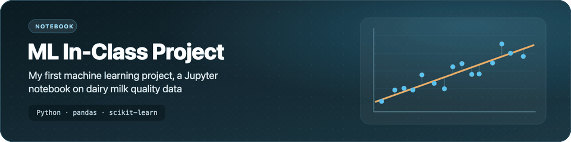

<p align="center">
  <picture>
    <source media="(prefers-reduced-motion: reduce) and (prefers-color-scheme: dark)" srcset="assets/banner-dark.svg">
    <source media="(prefers-reduced-motion: reduce)" srcset="assets/banner-light.svg">
    
  </picture>
</p>

<h1 align="center">ML In-Class Project</h1>

<p align="center">My first machine learning project: a Jupyter notebook that starts a clustering analysis of dairy milk quality data.</p>

<p align="center">
  
  
  
  
  
  
</p>

> **Status:** early work in progress. The notebook loads the dataset and lays out the analysis steps; the steps after loading have headings but no code yet, so there are no models or results.

## What's inside

- 📓 **`notebooks/dairymilk.ipynb`**: the analysis notebook.
- 🥛 **Data loading**: reads `DairyMilkQuality-20240223.csv` with pandas and prints the first rows.
- 🧭 **Planned steps** (section headings in the notebook): data preprocessing, feature selection, clustering algorithm, model training, model evaluation, and interpretation and analysis.
- 🧰 **Tools**: pandas, and scikit-learn's `StandardScaler` (imported for preprocessing).

## Dataset

The notebook expects `data/DairyMilkQuality-20240223.csv`. The file is **not included** in this repository. Based on the notebook's output, each row is one milk test with these columns:

| Column | Content |
|---|---|
| `No` | row number |
| `TestD`, `TestM`, `TestY` | test day, month and year |
| `TankID` | tank identifier |
| `Fat`, `Prot`, `Lact` | fat, protein and lactose |
| `SNF`, `TS` | solids-not-fat and total solids |
| `SCC` | somatic cell count |
| `Mlkcow` | not described in the notebook |
| `Farmsize` | `Small`, `Medium` or `Large` |

## Getting started

```bash
git clone https://github.com/Worakornk/ML_In-Class_Project.git
cd ML_In-Class_Project
python3 -m venv .venv
source .venv/bin/activate        # Windows: .venv\Scripts\activate
pip install -r requirements.txt
# copy DairyMilkQuality-20240223.csv into data/
jupyter lab notebooks/dairymilk.ipynb
```

## Project structure

```text
.
├── data/                 # place the CSV here (not committed)
├── notebooks/
│   └── dairymilk.ipynb
├── requirements.txt
├── .editorconfig
├── .gitignore
├── LICENSE
└── README.md
```

## License

[MIT](LICENSE). The dataset is not covered by this license and is not distributed here.
